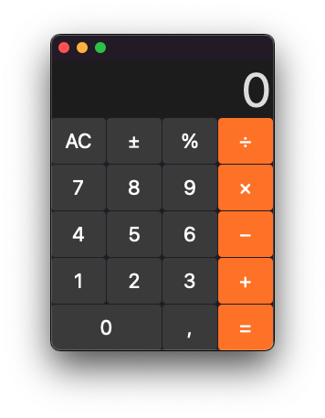
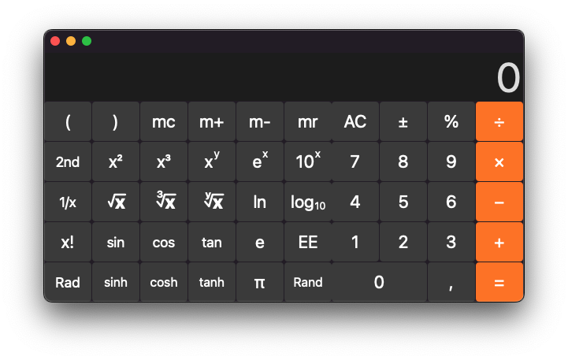
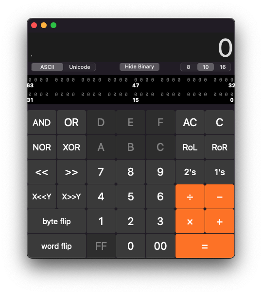

# UDCalc

This is a clone of the MacOSX built-in Calculator.app ported to GNUstep.





# Download

[Releases](https://github.com/ashalkhakov/UDCalc/releases) carry the Mac
app (a zip) and a Linux AppImage. The Mac app updates itself (Calculator >
Check for Updates…); the AppImage is updated by Gear Lever or AppImageUpdate.
A `v*` tag builds and attaches both (`.github/workflows/release.yml`); the
signing, notarization and `SPARKLE_PRIVATE_KEY` secrets live in the
repository's `production` environment.

# Testing under GNUstep

1. Ensure you have [`xctest`](https://github.com/gnustep/tools-xctest) tool installed.`
2. Go to CalculatorTests and run `make run-tests`
3. If you add new classes to the app that you want to test, please also add them to the CalculatorTests makefile

# Self-test (use cases, end to end)

`Calculator --self-test [filter]` runs the app and drives it from inside,
one use case at a time: buttons are clicked, shortcuts are sent as key
events and menu items are chosen from the main menu, so actions take the
user's path through the responder chain. Each Given/When/Then step prints
PASS or FAIL and the app exits with the number of failures. The scenarios
live in `Calculator/UDSelfTest.m`.

Headless, with a throwaway home so your own settings are not touched:

```sh
cd Calculator && make && cd ..
Tests/run-self-test.sh              # every scenario
Tests/run-self-test.sh menu         # features/scenarios whose name contains "menu"
FIRST_RESPONDER=1 Tests/run-self-test.sh   # leave menu items on the First Responder
```

Inside a running Gershwin session, `Calculator.app/Calculator --self-test`
runs against the real desktop.

# Trying it on Gershwin (dev) in Docker

`Tests/gershwin-dev/` builds Gershwin's unstable desktop from source in a
container you look at over VNC, with UDCalc built from this checkout and
started in it:

```sh
Tests/gershwin-dev/run.sh build      # once, ~30-40 min
Tests/gershwin-dev/run.sh desktop    # open vnc://localhost:5900 (password: gershwin)
Tests/gershwin-dev/run.sh selftest   # the self-test against that build
```

See `Tests/gershwin-dev/README.md`.

